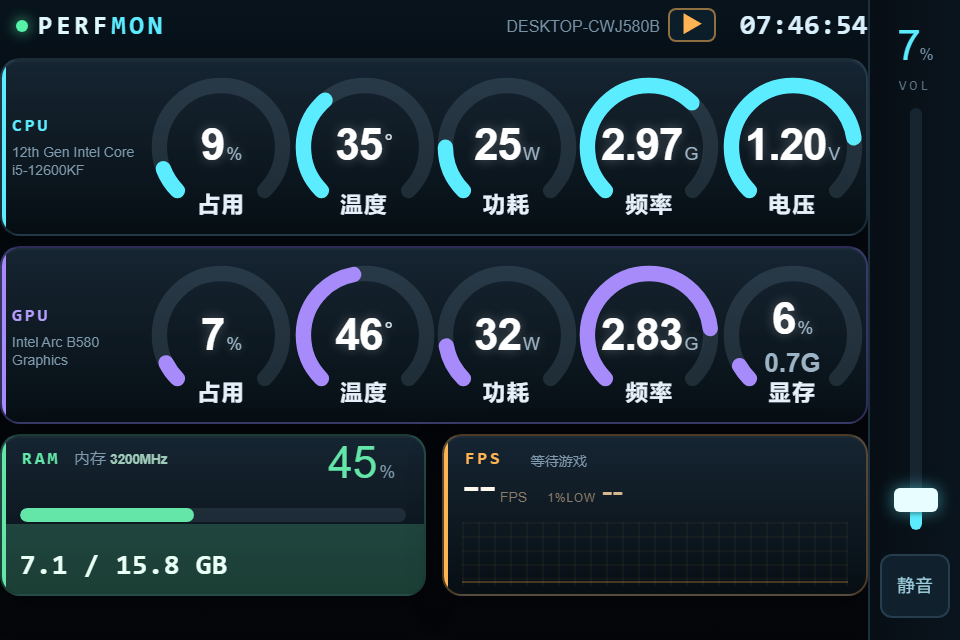

# LAN Perf Mon · 局域网性能监控

一个给 Windows 用的单文件性能监控程序：电脑端运行 `LanPerfMon.exe`，手机/平板在同一 Wi-Fi 下用浏览器打开局域网地址，即可实时查看 CPU、GPU、内存、FPS 和系统音量。

**目标设备：** iPhone 4S / iOS 6.1.3 Safari（同时兼容现代手机和桌面浏览器）


横屏预览：



---

## 1. 功能

| 项目 | 内容 |
| --- | --- |
| CPU | 5 个开口朝下的 3/4 圆仪表：占用率、温度、功耗、频率、电压；数值在圆心 |
| GPU | 5 个开口朝下的 3/4 圆仪表：占用率、温度、功耗、频率、显存占用 |
| 内存 | “内存”后跟 SMBios 读取的内存频率（如 3200MHz）+ 大号百分比 + 横向占用条 + 区块内颜色填充（绿/橙/红随占用变化）+ 加粗放大的已用/总计 |
| FPS | 平均帧大号显示 + **1% low（小一号，位于平均帧右侧同一行）** + 平均帧滚动心电图 |
| 音量 | 页面最右侧竖直滑动条，带 0–100 数值；支持静音/取消静音 |
| 时间 | 顶栏时钟加大字号，方便 iPhone 4S 小屏查看 |
| 网络 | 绑定局域网，端口可改；自动添加 Windows 防火墙入站规则 |
| 托盘 | 关闭窗口后留在托盘；可复制地址、打开页面、开机自启、退出 |
| 单文件 | 所有托管依赖、网页、图标、PresentMon 均嵌入一个 exe |

当前验证环境（编写本 README 时实测）：

- Windows 11 专业版（10.0.26300）
- Intel Core i5-12600KF
- NVIDIA GeForce RTX 3080（驱动 32.0.16.1062）
- 4 × 16 GB DDR4-3200（Micron）
- .NET Framework 4.8（4.8.09221）
- PresentMon 2.6.0（FPS，随 exe 内嵌）
- **未安装 PawnIO** — 因此 CPU 温度/功耗/电压显示 `--`，其余项正常

> 历史验证环境（早期在另一台机器上验证过，本仓库当前测试范围不含该配置）：
> Windows 11 10.0.26100、Intel Arc B580 Graphics（驱动 32.0.101.8974）、PawnIO 2.2、
> Intel Graphics Software。
>
> 需要说明的是：**GPU 数据在各版本中均由 LibreHardwareMonitorLib 读取**，
> 代码中没有任何 IGCL / `ControlLib.dll` 直读实现（见第 4 节）。

---

## 2. 快速使用

1. 双击 `LanPerfMon.exe`。
2. Windows 会弹出 UAC，请选择“是”。  
   **必须允许管理员权限**，否则 CPU 温度、功耗、电压和 FPS 会显示 `--`。
3. 主窗口会显示类似：
   `http://192.168.1.43:8686/`
4. 让 iPhone 4S 连接**同一个 Wi-Fi**，在 Safari 地址栏输入上面的地址。
5. 页面右侧的竖直滑条可以直接拖动调节电脑当前默认播放设备的音量；点“静音”切换静音。

关闭主窗口不会退出程序，而是缩到右下角托盘。要完全退出：右键托盘图标 → “退出”。

### 横屏 / 竖屏布局（真机识别失效时用）

主窗口底部有「布局:自动 / 布局:横屏 / 布局:竖屏」按钮，点一下循环切换：

- **自动**：网页按手机实际方向自动排布（默认）。
- **横屏**：强制手机页面使用横屏布局（CPU/GPU 标题居左竖排、仪表满高），即使手机竖着拿。
- **竖屏**：强制使用竖屏堆叠布局。

选择会立即下发给手机页面（网页每秒轮询 `/api/stats` 自动应用，无需刷新），并保存到 `LanPerfMon.ini` 的 `layout=`。

> iPhone 4S / iOS 6.1.3 的 Safari 对 `orientation` 媒体查询和旋转事件的识别不可靠，实测可能一直按横屏显示。若自动模式不对，直接用这个按钮强制成想要的方向即可。

### 修改端口

在主窗口“端口”输入框填入 1024–65535 之间的端口，点“应用端口”。程序会：

- 重启 HTTP 服务；
- 自动在 Windows 防火墙放行新端口；
- 保存到 exe 同目录的 `LanPerfMon.ini`（若目录不可写则保存到 `%APPDATA%\LanPerfMon\LanPerfMon.ini`）。

也可以命令行指定：

```bat
LanPerfMon.exe --port 9000
```

### 开机自启

勾选主窗口或托盘菜单里的“开机自动启动”。程序会创建一个名为 `LanPerfMon` 的 Windows 计划任务，登录时以最高权限启动，避免每次登录都弹 UAC。

注意：复选框的勾选状态会同时写入 `LanPerfMon.ini` 的 `autostart=`。若计划任务被外部删除
（例如手动 `schtasks /delete`、系统还原、或换到新机器），ini 里可能仍是 `autostart=1`
但实际不会自启；此时取消勾选再重新勾选一次即可重建任务。
任务是否存在可用 `schtasks /query /tn LanPerfMon` 确认。

---

## 3. iPhone 4S / iOS 6.1.3 兼容说明

页面是按 iOS 6 Safari 的能力集写的，不使用以下新特性：

- 不使用 ES6（`let` / `const` / 箭头函数 / Promise / fetch / 模板字符串）
- 不使用 CSS Flexbox / Grid / CSS 变量
- 不使用外部字体、外部 JS/CSS、CDN
- 使用 ES5 + `XMLHttpRequest` 每秒轮询
- 使用 `-webkit-linear-gradient`、`border-radius`、内联 SVG、`position:absolute/fixed`
- 自定义触摸滑条：`touchstart` / `touchmove` / `touchend`，不依赖 iOS 6 不支持的竖直 `input[type=range]`

布局适配：

- iPhone 4S 竖屏 320×480
- Safari 工具栏占用后的 320×372 可视区域会自动进入紧凑布局
- iPhone 4S 横屏 480×320：CPU/GPU 卡片的标题（标签+型号）移至**最左侧竖排**，不再占用顶部空间，仪表区占满整卡高度；FPS/RAM 重新分配高度，文字不重叠
- **横竖屏切换不再依赖 `@media (orientation)`**（iOS 6.1.3 Safari 对该特性识别不可靠，会错误地一直按横屏渲染）；改为 `<head>` 内联脚本根据视口宽高比 + `window.orientation` 计算并切换 `<html class="land">`，CSS 横屏规则全部挂在 `.land` 下
- **exe 主窗口提供「布局」按钮**（自动 → 横屏 → 竖屏 → 自动）：真机旋转识别失效时，点一下按钮即可强制手机页面切换布局。选择会写入 `LanPerfMon.ini` 的 `layout=`，并通过 `/api/stats` 的 `sys.layout` 下发给所有网页客户端，网页每秒轮询时自动应用
- 3/4 圆仪表使用内联 SVG 绘制，开口朝下，数值在圆心；描边为红→粉→紫→蓝渐变，进度弧带发光层，温度单位 ° 上标显示
- 页面最高只占一屏，不出现上下滚动
- 支持“添加到主屏幕”，已提供 `apple-touch-icon`

> 说明：开发环境无法连接真实 iPhone 4S，已使用 iOS 6.1.3 Safari User-Agent 在 320×480、320×372 和 480×320 视口下完成渲染验证；页面没有使用 iOS 6 不支持的前端 API。真机建议再实际打开确认一次。

---

## 4. 数据来源与限制

### CPU / GPU / 内存

通过 **LibreHardwareMonitorLib 0.9.6** 读取：

- CPU 占用：LHM `CPU Total`
- CPU 频率：LHM 核心 Clock；无权限时回退 `CallNtPowerInformation`
- CPU 电压/功耗/温度：LHM（需要管理员 + PawnIO/WinRing0 驱动）
- GPU：LHM 的 GPU 传感器（Intel / NVIDIA / AMD 通用），读取负载、频率、功耗、温度、显存
- 内存：LHM，失败时回退 `GlobalMemoryStatusEx`
- 内存频率：LibreHardwareMonitor 的 `SMBios.MemoryDevices`（优先 `ConfiguredSpeed`，否则额定 `Speed`）

> 早期文档曾写 GPU 走 Intel IGCL（`ControlLib.dll`）直读 Arc 显卡。
> 当前源码中不存在该实现（`IGCL` / `ControlLib` 在 `src/` 中零匹配），
> 所有 GPU 读数均来自 LibreHardwareMonitorLib，因此 NVIDIA / AMD 显卡同样可用。

如果 CPU 温度/功耗/电压显示 `--`：

1. 确认 exe 是以管理员身份运行；
2. 确认 PawnIO 已安装（默认安装于 `C:\Program Files\PawnIO`；不在该目录即视为未安装）；
3. 某些 Windows 11 版本会拦截 WinRing0 类驱动，PawnIO 是更稳妥的方案；
4. GPU 驱动更新后，LHM 的传感器通常也会恢复。

### FPS

内嵌 **PresentMon 2.6.0**（Intel 开源，MIT）：

- 程序把 `PresentMon-2.6.0.exe` 解压到 `%TEMP%\LanPerfMon\` 并以管理员权限运行；
- 通过 ETW 捕获 D3D/DXGI/Vulkan 的 Present 事件；
- 自动选择 FPS 数据源，依次尝试：
  1. 当前前台窗口进程（最近 5 秒内有帧）；
  2. 最近 5 秒内有帧、且窗口接近全屏的 3D 程序；
  3. 兜底：任何最近 5 秒内有帧且未被过滤的非系统进程；
- 浏览器、桌面、终端、Electron 壳等非游戏进程会被过滤；
- 没有游戏画面时显示“等待画面”，不会显示桌面动画的假 FPS；
- **1% low**：最近约 30 秒 / 最多 2400 帧中，取最慢 1% 帧时间的平均值换算成 FPS；
- **平均帧心电图**：页面保留最近 36 个采样点，用滚动折线绘制当前平均帧趋势。

如果 FPS 一直 `--`：

1. 确认游戏正在运行，且处于前台或全屏；
2. 确认程序以管理员身份运行（ETW 需要）；
3. 某些杀毒软件会阻止 ETW/PresentMon，加入白名单；
4. 同时运行 RTSS、Afterburner 等捕获工具可能冲突，先退出它们。
5. 若页面显示"需要管理员权限才能采集 FPS"，说明非管理员运行导致
   PresentMon 以退出码 6（ETW 权限不足）退出，右键以管理员身份运行即可。
   PresentMon 的英文原文仍记录在日志中。

### 音量

使用 Windows Core Audio 的 `IAudioEndpointVolume` 控制**当前默认播放设备**的主音量。切换耳机/音箱后，页面下一秒会自动读取新设备音量。

---

## 5. 局域网 / 防火墙 / 安全

- 默认监听 `0.0.0.0:8686`（所有网卡）。
- 首次启动会尝试执行 `netsh advfirewall firewall add rule`，规则名：
  `LanPerfMon TCP <端口>`，方向入站，协议 TCP，配置文件 Domain/Private/Public。
- HTTP 服务只接受**私有地址 / 回环地址**的客户端（10/8、172.16/12、192.168/16、127/8、169.254/16），公网来源会被直接关闭连接。
- 这是**无登录**的局域网工具：同一局域网内知道地址的人都能查看数据并调节音量。请只在可信家庭/办公室网络使用，**不要做端口映射到公网**。
- 如果防火墙规则添加失败，可手动放行：

```bat
netsh advfirewall firewall add rule name="LanPerfMon TCP 8686" dir=in action=allow protocol=TCP localport=8686 profile=any
```

- 如果手机打不开：
  1. 确认手机和电脑在同一 Wi-Fi（不是访客网络/AP 隔离）；
  2. 确认地址是主窗口显示的 `192.168.1.43:端口`；
  3. 关闭再打开 Windows 防火墙的入站规则；
  4. 路由器给电脑设置 DHCP 地址保留，避免 IP 变化。

---

## 6. 单文件与构建

发布文件：

```
dist\LanPerfMon.exe
```

单文件约 4.1 MB，内含：

- C# WinForms 托盘程序
- 内嵌网页（HTML/CSS/ES5 JS）
- LibreHardwareMonitorLib 0.9.6 及依赖
- PresentMon 2.6.0
- 应用图标

运行要求：Windows 10/11 x64，.NET Framework 4.8（Windows 10/11 自带）。

源码结构：

```
src/                 C# 源码
web/index.html       单页监控界面（iOS 6 兼容）
assets/app.ico       应用图标
app.manifest         requireAdministrator 清单
build.ps1            csc 一键构建
tools/lhm096/        LHM 依赖（构建时嵌入）
tools/PresentMon.exe 构建时嵌入
tools/cdp_shot.py    按视口截图（Edge headless + CDP），用于渲染验证
tools/es5_check.py   校验 web/index.html 内联脚本为 ES5 语法
dist/                输出目录（已在 .gitignore 中，不进版本库）
```

版本库约定：

- 本仓库用 Git 管理，`dist/`、`LanPerfMon.ini`、`tools/edge-shot-profile/`、
  `*.log` 及 `es5_check.py` 的生成物均被忽略。
- 工作区文件统一 LF 换行（`.gitattributes` 钉住 `eol=lf`），避免 Windows 上
  `core.autocrlf` 造成整文件伪差异。
- `tools/es5_check.py` 需要 `node` 可执行文件与 `tools/esprima.js`；缺失时脚本会
  明确报错退出，不会静默跳过。

构建：

```powershell
powershell -NoProfile -ExecutionPolicy Bypass -File .\build.ps1
```

构建脚本使用系统自带 .NET Framework 4.x 的 `csc.exe`，不需要安装 Visual Studio 或 .NET SDK。会同时生成：

- `dist\LanPerfMon.exe`：正式版，`requireAdministrator`
- `dist\LanPerfMonTest.exe`：测试版，`asInvoker`（仅开发调试用，功能不完整）

---

## 7. 常见问题

**Q：双击没反应 / 只在托盘里？**  
A：关闭窗口会缩到托盘，这是正常行为。双击托盘图标恢复。

**Q：端口修改后手机还是旧地址？**  
A：手机页面还在轮询旧端口。用新地址重新打开；主窗口的“复制地址”会给出新 URL。

**Q：CPU 频率显示 3.7 GHz，但任务管理器显示更高？**  
A：这是所有核心的实时平均频率；满载/单核睿频时会变化。频率圆环的进度按本次运行观察到的最高频率缩放，圆心数值始终显示当前频率。

**Q：FPS 显示的是浏览器/桌面？**  
A：已过滤浏览器、桌面、终端、Electron 等进程；只显示前台或接近全屏的 3D 程序。若仍有误判，可把进程名反馈给我。

**Q：Windows 提示“未知发布者”/SmartScreen？**  
A：exe 没有购买代码签名证书。可以点“更多信息 → 仍要运行”。硬件传感器驱动也可能触发杀毒误报，需加入信任。

**Q：日志在哪里？**  
A：`%TEMP%\LanPerfMon\LanPerfMon.log`，包含启动、端口、PresentMon 状态，便于排查。

---

## 8. 第三方组件

详见 [THIRD-PARTY-NOTICES.txt](THIRD-PARTY-NOTICES.txt)。

- LibreHardwareMonitorLib 0.9.6 — MPL-2.0
- PresentMon 2.6.0 — MIT
- PawnIO — 系统驱动，未随 exe 分发
- HidSharp、System.Memory 等 — 各自开源许可证

本项目仅用于个人/家庭局域网监控，不提供任何硬件损坏或数据准确性担保。
